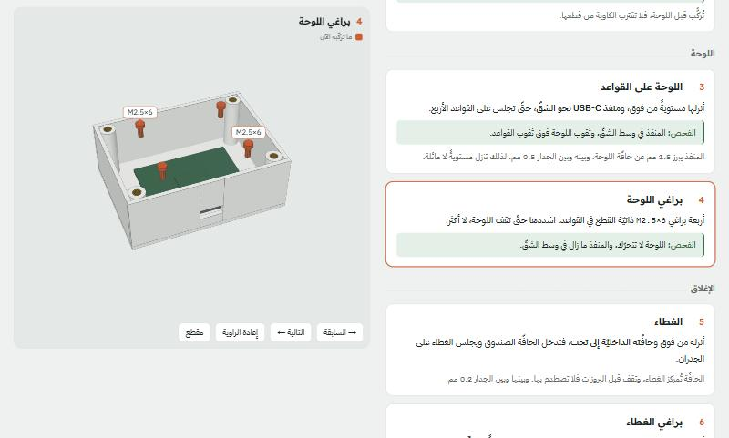

# Assembly Guide Skill: 3D assembly guides from your CAD

A Claude Code skill. Ask Claude "how do I put this together?" for a device you have the CAD of, and it builds **one HTML page**: numbered steps on one side, and a 3D bench on the other that shows the device after each step as you scroll.



- **The part you fit now is orange**, and it moves in along its real insertion direction.
- **Every part comes from the CAD itself**, and every number in the text is measured from it.
- **Every step is checked before it is written:** can a screwdriver reach that screw? Does the part slide in without hitting what is already installed? Does the order need a printed part to bend?

Arabic version: [README.md](README.md)

## Try the example

`example/` is a small electronics box in eight steps: a box and a lid, a board on four standoffs, and four heat-set inserts. Every part is drawn in code, so it needs no Fusion and no CAD file.

The page is already built in `example/standalone.html`. Serve it locally:

```
python -m http.server 8000 --directory example
```

then open `http://localhost:8000/standalone.html`. The page needs internet access to load three.js and the fonts.

To rebuild it after a change:

```
pip install numpy trimesh
python example/build_parts.py
python build_html.py example example-box
```

## What's in the package

| File | What it is |
|---|---|
| `SKILL.md` | The skill itself: method, rules and checks. Claude reads it |
| `example/template.html` | The page and the viewer. Copy it for every new guide, keep the viewer engine, rewrite the parts and the steps |
| `example/build_parts.py` | Groups the parts, draws the bought hardware (screws, inserts, cables), writes `parts.json` |
| `build_html.py` | Template + `parts.json` → an artifact page and `standalone.html` |
| `fusion_export_meshes.py` | Exports every body of an assembly from Fusion in one frame, in mm, with the round holes and the parameters. Read-only |
| `reach_check.py` | Can a straight tool reach this screw? Casts thousands of rays from the spot and counts how many escape |

## Installation

You need [Claude Code](https://claude.com/claude-code), and Python 3 with `numpy` and `trimesh`.

```
git clone https://github.com/Sniper797/Assembly-Guide-Skill.git ~/.claude/skills/building-3d-assembly-guides
```

On Windows the folder is `%USERPROFILE%\.claude\skills\building-3d-assembly-guides`. Claude Code picks the skill up in the next session.

**With Fusion:** the export from Fusion runs through [FusionAgent](https://github.com/Sniper797/Fusion-Agent). Without Fusion, put the STL files of the parts in a folder and tell Claude where they are.

**Updating:** `git pull` inside the folder.

## Usage

Open Claude Code in your project folder and ask in plain words, for example: "explain how to assemble the design open in Fusion" or "make an assembly guide from the STL files in parts". The skill starts on its own and goes through these stages:

1. **Parts:** every body exported in the same assembly frame, and the bought hardware drawn from its dimensions.
2. **Steps:** one action per step. Each has a check (how you know it worked), a warning only for a real trap, and a "why".
3. **Checks:** tool reach to every screw, a collision-free path for every part, the order, then the page on desktop and phone.
4. **Not tried yet:** a closing section that lists every assumption. If it finds a design flaw it tells you, and never redesigns silently.

## License

Copyright (c) 2026 Mohammad Ghassan. Released under the [PolyForm Strict License 1.0.0](LICENSE.md):

- **Allowed:** downloading and using it for learning, experiments and personal projects, and at universities and non-profit organizations.
- **Not allowed without written permission:** changing it, building other work on it, redistributing or passing it on, or commercial use. Anyone who wants it should download it from here.

For permission or collaboration, reach out on [GitHub](https://github.com/Sniper797).

---

**العربيّة:** الدليل كاملاً بالعربيّة في [README.md](README.md).
