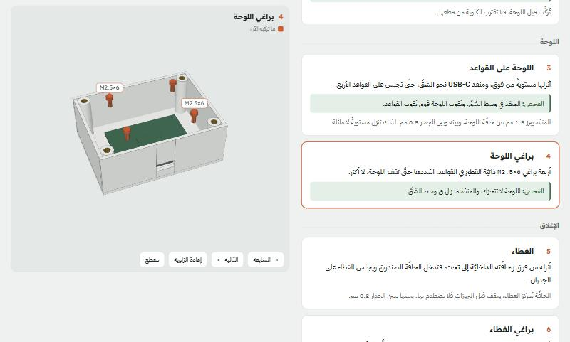

# Assembly Guide Skill — دليل تركيبٍ ثلاثيّ الأبعاد من ملفّ التصميم

مهارةٌ لـ Claude Code: حين تسأله «كيف أركّب هذا الجهاز؟» وعندك ملفّ تصميمه، يبني لك **صفحة HTML واحدة**. على جانبٍ خطواتٌ مرقّمة، وعلى الجانب الآخر عارضٌ ثلاثيّ الأبعاد يُظهر الجهاز بعد كلّ خطوة، وأنت تنزل في الصفحة.



- **القطعة التي تركّبها الآن برتقاليّة**، وتدخل مكانها من اتّجاه تركيبها الحقيقيّ.
- **كلّ قطعةٍ من ملفّ التصميم نفسه**، وكلّ رقمٍ في النصّ مقيسٌ منه.
- **كلّ خطوةٍ تُفحص قبل أن تُكتب:** هل يصل المفكّ إلى البرغي؟ هل تمرّ القطعة دون أن تصطدم بما رُكّب قبلها؟ هل يحتاج الترتيب ثني قطعةٍ مطبوعة؟

النسخة الإنجليزيّة: [README.en.md](README.en.md)

## جرّب المثال

في `example/` صندوق إلكترونيّات صغير في ثماني خطوات: صندوقٌ وغطاء، ولوحةٌ على أربع قواعد، وأربعة إنسرتات. كلّ قطعه مرسومةٌ بالكود، فلا يحتاج Fusion ولا أيّ ملفّ تصميم.

الصفحة مبنيّةٌ جاهزة في `example/standalone.html`. افتحها من خادمٍ محلّيّ:

```
python -m http.server 8000 --directory example
```

ثمّ افتح `http://localhost:8000/standalone.html`. تحتاج الصفحة الإنترنت لتحميل three.js والخطوط.

ولإعادة بنائها بعد أن تعدّل شيئاً:

```
pip install numpy trimesh
python example/build_parts.py
python build_html.py example example-box
```

## ما في الحزمة

| الملفّ | ما هو |
|---|---|
| `SKILL.md` | المهارة نفسها: الطريقة والقواعد والفحوص، يقرؤها Claude |
| `example/template.html` | الصفحة والعارض. انسخه لكلّ دليلٍ جديد، وأبقِ محرّك العارض، وأعد كتابة القطع والخطوات |
| `example/build_parts.py` | يجمع القطع ويرسم ما يُشترى (براغي، إنسرتات، أسلاك)، ويكتب `parts.json` |
| `build_html.py` | القالب و`parts.json` ← صفحة artifact و`standalone.html` |
| `fusion_export_meshes.py` | يصدّر كلّ أجسام التجميع من Fusion في إطارٍ واحد، بالملّيمتر، مع الثقوب والمعاملات. للقراءة فقط |
| `reach_check.py` | هل تصل أداةٌ مستقيمة إلى هذا البرغي؟ يرمي آلاف الخطوط من موضعه ويعدّ ما يخرج منها |

## التثبيت

تحتاج [Claude Code](https://claude.com/claude-code)، وPython 3 مع `numpy` و`trimesh`.

```
git clone https://github.com/Sniper797/Assembly-Guide-Skill.git ~/.claude/skills/building-3d-assembly-guides
```

على Windows يصير المجلّد `%USERPROFILE%\.claude\skills\building-3d-assembly-guides`. يجد Claude Code المهارة وحده في الجلسة التالية.

**مع Fusion:** التصدير من Fusion يمرّ عبر [FusionAgent](https://github.com/Sniper797/Fusion-Agent). ومن غير Fusion، ضع ملفّات STL للقطع في مجلّد، وقل لـ Claude أين هي.

**التحديث:** `git pull` داخل المجلّد.

## الاستعمال

افتح Claude Code في مجلّد مشروعك، واطلب بالكلام، مثل: «اشرح طريقة تركيب الجهاز المفتوح في Fusion» أو «اعمل دليل تركيب من ملفّات STL في مجلّد parts». تبدأ المهارة وحدها، وتمرّ بهذه المراحل:

1. **القطع:** يصدّر كلّ جسمٍ في إطار التجميع نفسه، ويرسم ما يُشترى من مقاساته.
2. **الخطوات:** خطوةٌ واحدة لكلّ فعل. لكلٍّ منها «الفحص» (كيف تعرف أنّها نجحت)، وتنبيهٌ للفخّ الحقيقيّ وحده، و«لماذا».
3. **الفحوص:** الوصول إلى كلّ برغي، ومسار كلّ قطعةٍ بلا اصطدام، والترتيب، ثمّ الصفحة على الحاسوب والجوال.
4. **ما لم يُجرَّب:** قسمٌ في آخر الصفحة يذكر كلّ افتراض. وإن وجد خللاً في التصميم يقوله لك، ولا يعدّل التصميم بصمت.

## الرخصة

حقوقه محفوظة لمحمد غسان، ويُنشر برخصة [PolyForm Strict 1.0.0](LICENSE.md):

- **مسموح:** تنزيله واستعماله في التعلّم والتجربة والمشاريع الشخصيّة، وفي الجامعات والجهات غير الربحيّة.
- **ممنوع دون إذنٍ مكتوب:** تعديله، أو بناء عملٍ عليه، أو إعادة نشره أو إرساله لغيرك، أو استعماله تجاريّاً. من أراده فلينزّله من هنا.

للإذن أو للتعاون: تواصل عبر [GitHub](https://github.com/Sniper797).

---

**English:** the full guide in English is in [README.en.md](README.en.md).
